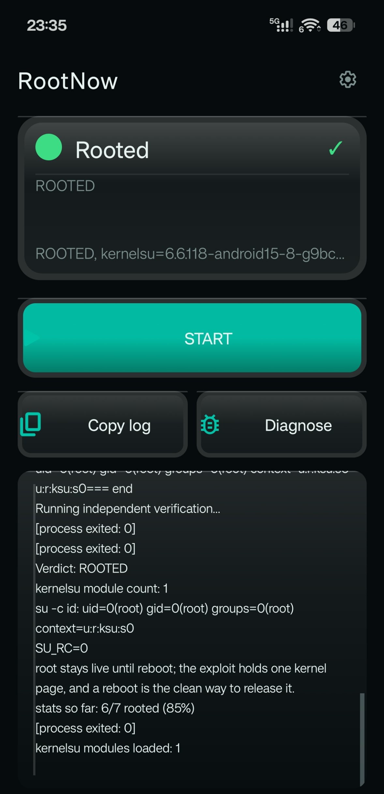
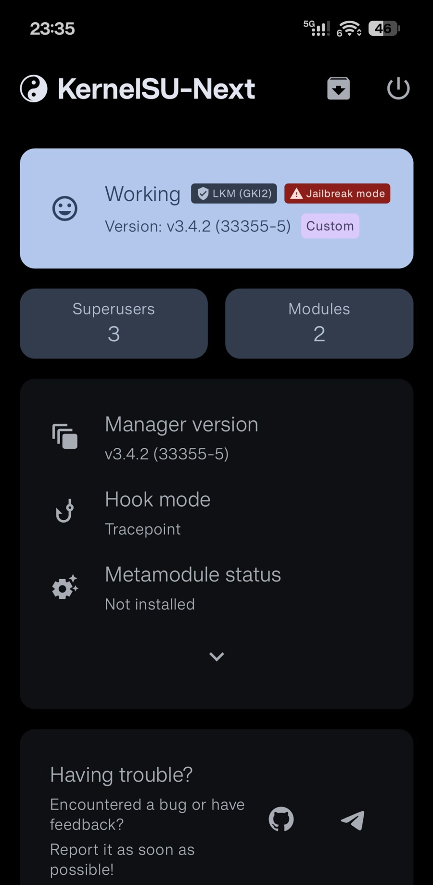
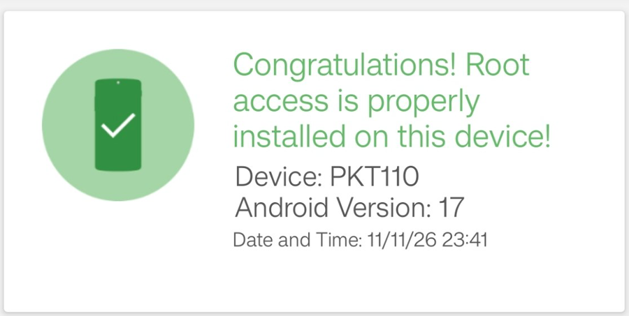
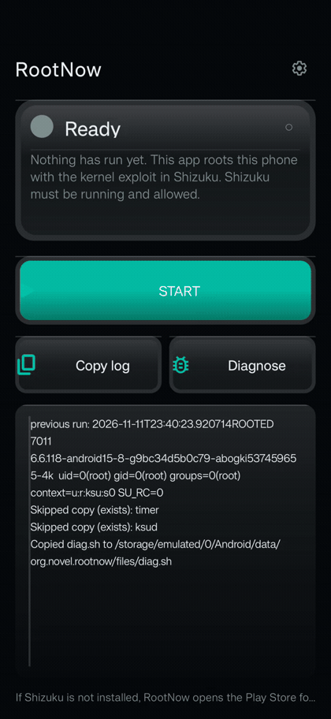

# RootNow

**Temporary root for locked-bootloader OPPO / ColorOS phones.** One tap, about five seconds, no
unlock, no fastboot, no data wipe.


OPPO stopped handing out bootloader unlocks, so the usual route — unlock, flash a patched boot
image, install KernelSU — is closed. This repo is the other route: a kernel timer-page exploit
that wins root on a locked device, the Android app that runs it, and the operational discipline
that turns a ~60% race into a tool you can actually use.

**Verified working on a retail OPPO Find X8s (PKT110) running the latest ColorOS 17 / Android 17
build as of mid-November 2026**, bootloader locked:

| | |
|---|---|
| Version number | `PKT110_17.0.0.102(CN01C10P02)` |
| Android | 17, security update 1 September 2026 |
| Kernel | `6.6.118-android15-8-g9bc34d5b0c79-abogki537459655-4k` |
| Bootloader | locked, unlock not available |

Root was reproduced on that build repeatedly (see the measured results below), not on an older
firmware. The kernel release is the line that matters — if yours differs, the constants do not
apply. [Settings screenshot](docs/img/about-device.jpg).

<p align="center">
  
</p>

## Proof it is real root

The app saying "rooted" proves nothing on its own. Two independent apps agree:

<p align="center">
  
  
</p>

Left: KernelSU-Next sees a loaded LKM in jailbreak mode, with superusers and modules. Right: a
third-party checker that has no knowledge of this project reports root present on the device.

## What you get

- `uid=0(root)` with SELinux context `u:r:ksu:s0` — real root, not a fake shell
- Runs on top of Shizuku (shell-level execution) — no bootloader unlock, no data wipe
- KernelSU late-loaded (`ksud --kmi android15-6.6`), so `su` and its module path exist
- Survives app restarts, **dies at reboot** — reboot is also the cleanup
- Reversible by design: each run parks one kernel page, and a reboot releases it

## See it run

<p align="center">
  
</p>

Tap Start, wait about five seconds, and KernelSU-Next confirms the module is loaded. In this take
the exec completed in **296 ms** and the page was reclaimed **1237 ms** after the free — which is
why the old 400 ms wait window was marginal and why it now allows 10 s.
([higher-quality MP4](media/rootnow-demo.mp4))

## Quick start

```bash
sha256sum -c dist/SHA256SUMS      # 1. verify
adb install -r dist/RootNow-v4.9.apk   # 2. sideload (debug-signed)
```

0. **Install Shizuku and start it.** RootNow runs the payload through Shizuku's user service as the
   shell user; the exploit is what turns that into root. Grant RootNow the Shizuku permission.
1. **Reboot** the phone before the first run — a parked page from an earlier attempt blocks every
   retry in that boot.
2. Charge above **30%** and turn **battery saver off**. The spray is CPU-bound; a throttled phone
   loses the page race.
3. Press **Start** once. Root lands in 3–5 s.
4. Confirm independently: `su -c id` → `uid=0(root) … context=u:r:ksu:s0`.

If it fails, **reboot before retrying**. The app enforces this with a boot marker instead of
letting you burn another boot.

## How it works

1. **Plant** — a freed timer page is reused so a controlled object lands where the kernel will use
   it (page ids `277,275`, free set `275,276,279` on this build).
2. **Fake credentials** — that object is shaped into a credential struct, so a child process
   reports `uid=0` while the spray holds the page.
3. **Late-load KernelSU** — with the primitives in place, `ksud` loads the KernelSU module and `su`
   becomes available.

Every constant is derived from the matching `vmlinux`; the recipe and the address table are in
[`docs/BUILD.md`](docs/BUILD.md).

## Measured, not promised

| Metric | Result |
|---|---|
| Success on first plant | **6 of 7 runs** |
| Time to root | **3–5 s** (`kernelsu loaded after 3-5s`) |
| Failure classes seen | `no zombie` ×2, `burst hit=0` ×2 |
| Cost of a lost run | one reboot (~1 min) |
| Payload rebuild | reproducible, byte-verified strings |

The exploit is a race, not a switch. The two failure modes need different fixes:

| Log line | Meaning | What changed |
|---|---|---|
| `no zombie after Nms` | exec thread didn't finish inside the wait window | window widened 400 ms → 10 s |
| `burst hit=0 after 15000ms` | page freed, spray lost it to a system allocation | preflight blocks low charge / battery saver |
| `stage selinux failed` | SELinux-state write missed | treat as a lost race; reboot |
| `su verification FAILED` | usually **not** a failure — the check ran before ksud finished | app re-verifies and overrules it |

Per-attempt checklist: [`docs/RUNBOOK.md`](docs/RUNBOOK.md).

## Limits — read before installing

- **Root dies at reboot.** Every boot needs a new run.
- **Play Integrity trips.** Banking and some payment apps may refuse to run with root present.
- **Pinned to one kernel build.** A system update breaks the exploit until the constants are
  re-derived; `STATIC_TIMER_SITE` can only come from a live trace, never from symbols.
- **A lost race can panic the device.** It happened once here, on a first-boot attempt.
- **One device tested.** This is not a claim about other OPPO, OnePlus or realme models.

**Not for you if:** your bootloader can be unlocked (use fastboot and a proper KernelSU install),
you need root across reboots, or you are not willing to reboot to recover.

## Repo layout

```
README.md           this file
SKILL.md            the Hermes skill: triggers, procedure, pitfalls
docs/RUNBOOK.md     per-attempt checklist and the failure → action table
docs/BUILD.md       payload rebuild recipe, constants, tuning knobs
docs/APP-NOTES.md   boot guard, independent verification, log integrity
media/              screenshots used in this README
dist/               the APK and its checksum
```

What is **not** here: the payload source, the KernelSU daemon source, and the Android app source.
The APK in `dist/` does bundle the compiled payload and `ksud` as assets — it cannot run without
them.

## Credits

- [KernelSU](https://github.com/tiann/KernelSU) and [KernelSU-Next](https://github.com/KernelSU-Next/KernelSU-Next) —
  the in-kernel `su` this exploit late-loads; the manager in the screenshot is KernelSU-Next v3.4.2
- [Magisk](https://github.com/topjohnwu/Magisk) — the prior art that made Android root legible

## License

MIT — see [LICENSE](LICENSE). Use it only on hardware you own.
